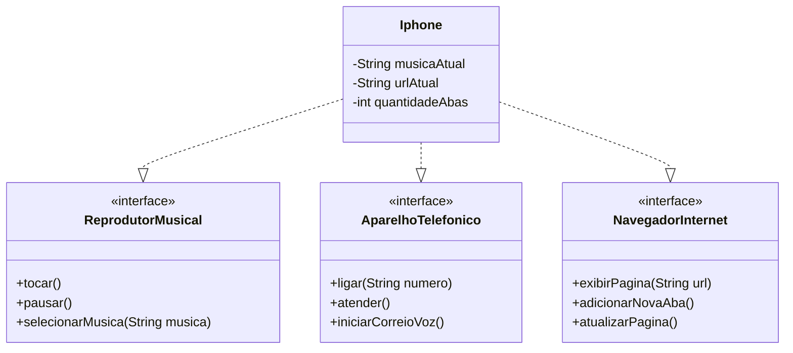

# 📱 Modelagem do iPhone com UML e Java

Projeto desenvolvido como parte do desafio de Programação Orientada a Objetos da [Digital Innovation One (DIO)](https://www.dio.me/).

## Objetivo

Representar as funcionalidades do iPhone como reprodutor musical, aparelho telefônico e navegador de internet, aplicando conceitos de POO e modelagem UML.

## Tecnologias utilizadas

- Java (JDK 11 ou superior)
- Programação Orientada a Objetos (POO)
- UML — Diagrama de Classes
- Git e GitHub

## Funcionalidades

### 🎵 Reprodutor Musical
- Selecionar música
- Tocar música
- Pausar reprodução

### 📞 Aparelho Telefônico
- Realizar ligação
- Atender chamada
- Acessar correio de voz

### 🌐 Navegador de Internet
- Exibir página
- Adicionar nova aba
- Atualizar página

## Modelagem UML

O diagrama abaixo representa a classe `Iphone` implementando as três interfaces.



## Estrutura do projeto

```text
desafio-iphone-java/
├── src/
│   ├── AparelhoTelefonico.java
│   ├── Iphone.java
│   ├── Main.java
│   ├── NavegadorInternet.java
│   └── ReprodutorMusical.java
└── README.md
```

## Como executar

É necessário ter o JDK instalado. No terminal, na raiz do projeto, execute:

```bash
javac -d out src/*.java
java -cp out Main
```

## Exemplo de saída

```text
=== REPRODUTOR MUSICAL ===
Música selecionada: Imagine - John Lennon
Tocando: Imagine - John Lennon
Reprodução pausada.

=== APARELHO TELEFÔNICO ===
Ligando para: 11999999999
Atendendo chamada.
Acessando correio de voz.

=== NAVEGADOR DE INTERNET ===
Exibindo página: https://www.google.com
Nova aba adicionada. Total: 2
Atualizando página: https://www.google.com
```

## Referência

Desafio de POO da trilha Java Básico da DIO:  
https://github.com/digitalinnovationone/trilha-java-basico/tree/main/desafios/poo
